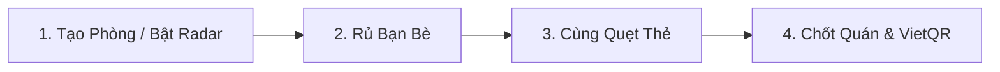

# 🍽️ Hôm Nay Ăn Gì? — Nền Tảng Chọn Quán & Kết Nối Ẩm Thực Thông Minh

<p align="center">
  <strong>Giải pháp cứu cánh cho câu hỏi muôn thuở của mọi nhóm bạn: <em>"Hôm nay ăn gì? Trưa nay đi đâu?"</em></strong>
</p>

<p align="center">
  
</p>

---

## 💡 Giới Thiệu Chung

Bạn đã bao giờ rơi vào cảnh cả nhóm bạn đứng giữa ngã tư đường và hỏi nhau *"Ăn gì cũng được"*, nhưng gợi ý món nào cũng bị từ chối? 

**Hôm Nay Ăn Gì?** ra đời để biến việc lựa chọn quán ăn từ một cuộc tranh luận kéo dài thành một **trò chơi tương tác nhóm thú vị, công bằng và nhanh chóng**. Ứng dụng kết hợp giữa trải nghiệm quẹt thẻ trực quan (tương tự Tinder), công nghệ đồng bộ thời gian thực, radar tìm bạn cùng khẩu vị và tính năng quyết toán hóa đơn tự động qua mã VietQR.

---

## ✨ Điểm Nhấn & Tính Năng Nổi Bật

### 🎴 1. Quẹt Thẻ Chọn Quán Nhóm (Group Swipe & Instant Match)
- **Cơ chế biểu quyết trực quan:** Các thành viên trong phòng cùng lướt qua bộ sưu tập quán ngon quanh vị trí hiện tại. Vuốt sang phải nếu bạn "thích", vuốt sang trái để "bỏ qua".
- **Khoảnh khắc bùng nổ (Consensus Match):** Ngay khi tất cả thành viên trong nhóm cùng thích chung một quán ăn, hệ thống sẽ lập tức khóa quán và kích hoạt hiệu ứng pháo hoa rực rỡ để chúc mừng!
- **Tương tác sinh động:** Hiệu ứng bắn tim thời gian thực xuất hiện mỗi khi có người trong phòng vừa ưng ý một địa điểm.

### 📡 2. Radar Dò Tìm Bạn Ăn & Khám Phá Phòng Công Khai
- **Đi ăn một mình nhưng không cô đơn:** Kích hoạt chế độ Radar để tìm kiếm những người bạn có cùng "gu" ăn uống hoặc cùng tâm trạng (thèm lẩu cay, đồ nướng, món thanh đạm...) trong khu vực lân cận.
- **Tham gia tức thì:** Khám phá danh sách các phòng ăn công khai xung quanh bạn và tham gia chỉ với một nút bấm.

### 📍 3. Gợi Ý Quán Thông Minh Theo GPS & Tâm Trạng (Mood Tags)
- **Bộ lọc vị trí chính xác:** Tự động tìm kiếm các quán ăn chất lượng theo bán kính GPS linh hoạt (1km, 3km, 5km, 10km).
- **Chọn quán theo cảm xúc:** Lựa chọn các thẻ tâm trạng ẩm thực trong ngày để nhận danh sách gợi ý phù hợp nhất với khẩu vị hôm nay.
- **Chế độ Solo (Ăn Một Mình):** Bạn muốn tự thưởng cho bản thân một bữa ngon? Bật chế độ Solo để quẹt thẻ và tìm quán cho riêng mình trong tích tắc.

### 💸 4. Quyết Toán Hóa Đơn & Mã VietQR Tự Động
- **Không còn cảnh "ngại ngùng" tính tiền:** Sau bữa ăn, chủ phòng có thể tạo hóa đơn và chia tiền minh bạch: chia đều cho cả nhóm (`EVENLY`) hoặc chia chi tiết theo từng món (`BY_ITEM`).
- **Thanh toán 1 chạm:** Tự động tạo mã chuyển khoản ngân hàng **VietQR** chuẩn xác kèm số tiền và nội dung cho từng người, quét mã thanh toán xong ngay trong 3 giây.
- **Theo dõi công nợ rõ ràng:** Quản lý danh sách các khoản nợ bữa ăn cá nhân, nhận thông báo nhắc nhở thanh toán văn minh.

### 👥 5. Kết Nối Bạn Bè & Lời Mời Trực Tiếp
- **Mạng xã hội ẩm thực:** Kết bạn, quản lý danh bạ những "cạ cứng" ăn uống.
- **Mời bạn một chạm:** Mời bạn bè tham gia phòng ăn nhanh chóng qua mã phòng 6 ký tự hoặc thông báo lời mời trực tiếp trên màn hình.

---

## 🎯 Trải Nghiệm 4 Bước Đơn Giản



1. **Bước 1 — Khởi tạo:** Tạo phòng ăn riêng tư cùng hội bạn hoặc bật Radar tìm kiếm nhóm ăn công khai theo vị trí và tâm trạng.
2. **Bước 2 — Tập hợp:** Gửi mã phòng 6 ký tự cho bạn bè cùng vào sảnh chờ.
3. **Bước 3 — Lướt thẻ:** Cả nhóm cùng quẹt các quán ăn hấp dẫn được tuyển chọn quanh khu vực.
4. **Bước 4 — Thưởng thức & Thanh toán:** Cùng đến quán ăn đã được chốt chung, tận hưởng bữa ăn và chia tiền nhanh gọn qua VietQR!

---

## 🎨 Trải Nghiệm Giao Diện Hiện Đại (UI/UX)

- **Thiết kế Mobile-First:** Giao diện tối ưu hoàn hảo cho điện thoại thông minh, đồng thời tương thích mượt mà trên máy tính bảng và màn hình máy tính.
- **Cử chỉ mượt mà:** Hiệu ứng vuốt chạm tự nhiên, phản hồi xúc giác nhẹ nhàng và chuyển cảnh tinh tế mang lại cảm giác thích thú khi sử dụng.
- **Đồng bộ thời gian thực:** Kết nối ổn định, tự động cập nhật mọi hành động của bạn bè trong phòng chờ và bàn quẹt mà không cần tải lại trang.

---

## 🚀 Bắt Đầu Trải Nghiệm Nhanh

Nếu bạn là nhà phát triển hoặc người muốn trải nghiệm thử nghiệm ứng dụng trên máy cá nhân:

### 1. Cài đặt mã nguồn
```bash
# Cài đặt các gói phụ thuộc
npm install
```

### 2. Khởi chạy ứng dụng
```bash
# Khởi chạy giao diện thử nghiệm
npm run dev
```
👉 Mở trình duyệt và truy cập: **`http://localhost:5173`**

### 3. Đóng gói ứng dụng
```bash
npm run build
```

---

## 💌 Thông Điệp Từ Đội Ngũ Phát Triển

> *"Bữa ăn ngon không chỉ nằm ở hương vị món ăn, mà còn ở sự vui vẻ, gắn kết và đồng điệu của những người cùng ngồi chung một bàn."*

**Hôm Nay Ăn Gì?** mong muốn trở thành người bạn đồng hành thân thiết, giúp mọi cuộc hẹn ăn uống của bạn và người thân luôn tràn ngập niềm vui và sự hào hứng!
